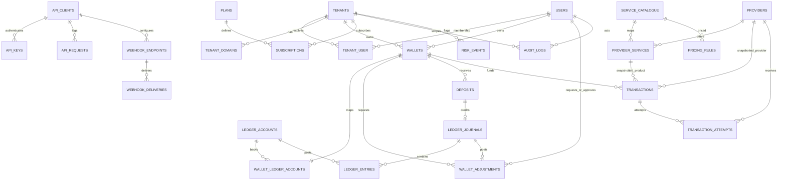

# Initial entity relationship map

The migration set also includes payment event idempotency, KYC records, risk events, reconciliation runs, notifications, outbox events, support tickets, Spatie role/permission tables, Sanctum tokens, queue tables and audit logs. Tenant-owned reads must always derive tenant identity from the verified request hostname and active membership, never a caller-supplied `tenant_id`.
